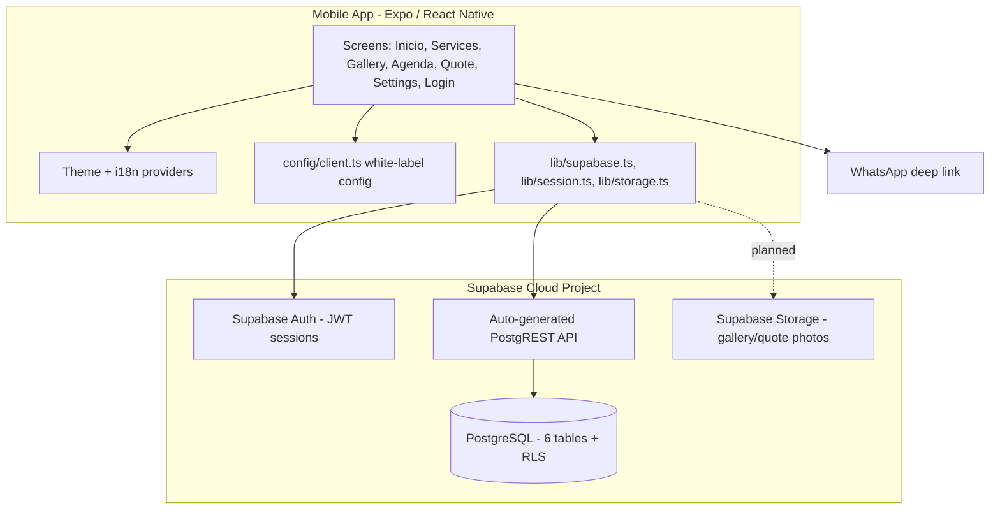
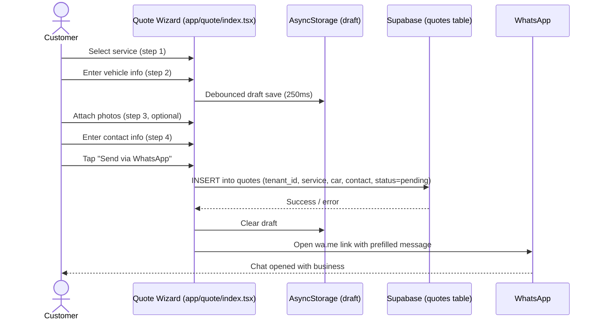

# ClientRadarX — Architecture & Sequence Diagrams

Companion to `docs/er-diagram.md`. Render with any Mermaid-compatible tool
and paste into the Final Report alongside the ER diagram, as planned in the
Interim Report's Future Work section (component diagram + sequence diagram
for the quote submission flow).

## Component diagram

## Sequence diagram — Quote submission flow

