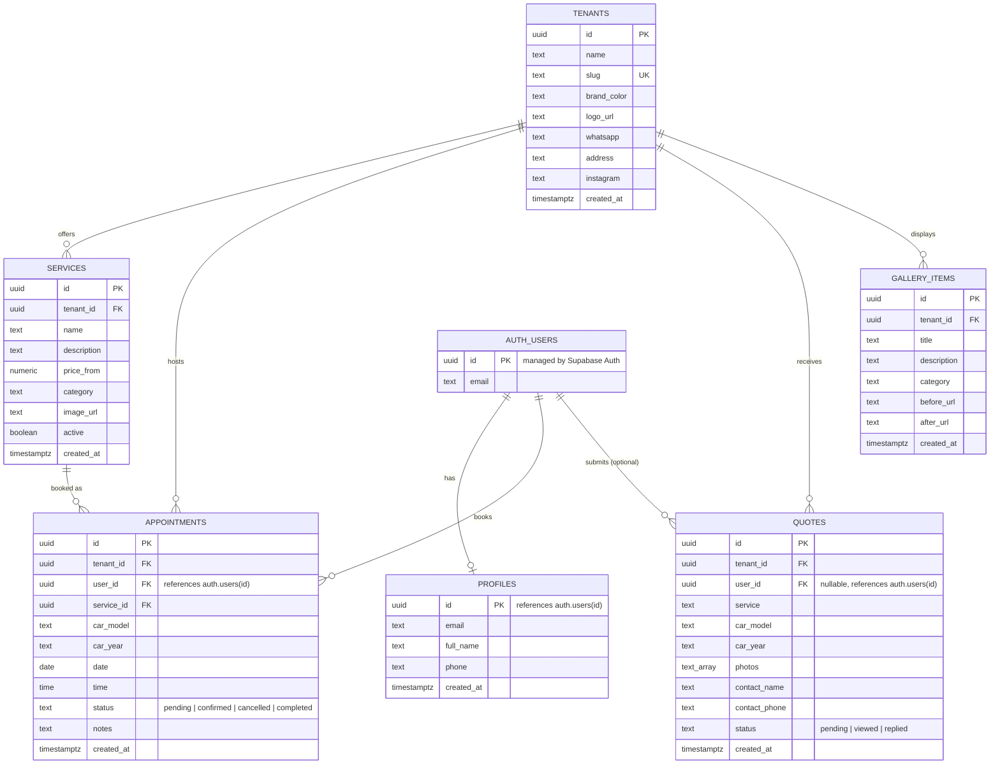

# ClientRadarX — Entity-Relationship Diagram

Reflects the schema defined in `supabase/migrations/20260610000000_init.sql`.
Render this with any Mermaid-compatible tool (e.g. https://mermaid.live, the
Mermaid VS Code extension, or Mermaid support in Word/Notion) and paste the
resulting image into the Final Report's Specification and Design section.

## Row Level Security summary

| Table | Read | Write |
|---|---|---|
| `tenants` | public | — |
| `profiles` | owner only (`auth.uid() = id`) | owner only |
| `services` | public, `active = true` only | — |
| `appointments` | owner only (`auth.uid() = user_id`) | owner only |
| `quotes` | owner only (`auth.uid() = user_id`) | anyone can insert (supports unauthenticated quote requests) |
| `gallery_items` | public | — |

A trigger (`handle_new_user`) auto-creates a `profiles` row whenever a new
`auth.users` record is created, populating `full_name` from sign-up metadata
or the email's local part as a fallback.

## Multi-tenancy note

Every business-data table carries a `tenant_id` foreign key into `tenants`,
which is what allows this schema to support shared multi-tenancy if a future
deployment needs it. The current deployment uses a white-label **silo**
model instead (one Supabase project per client, see Interim Report §3.1 and
§6.3) — `TENANT_ID` in `config/client.ts` is a compile-time constant rather
than a runtime-selected value, but every query still filters by it so the
same schema works unmodified under either model.
